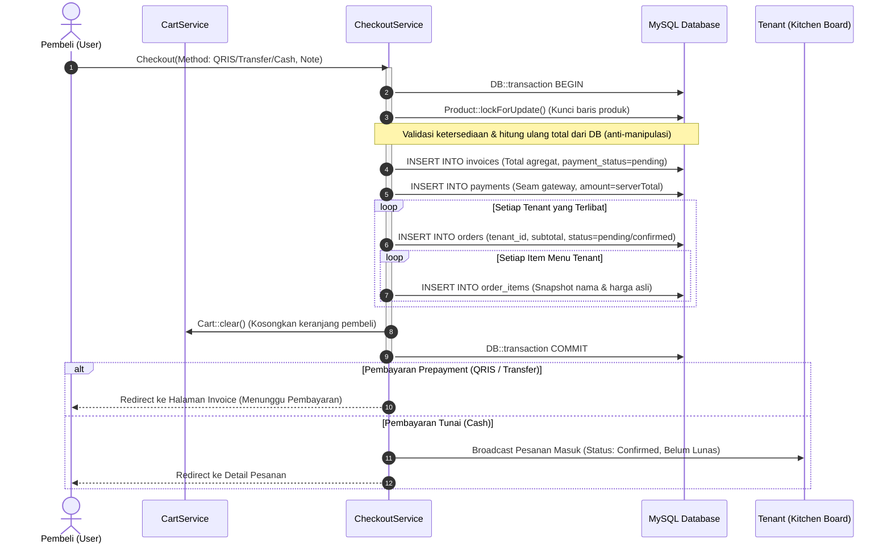
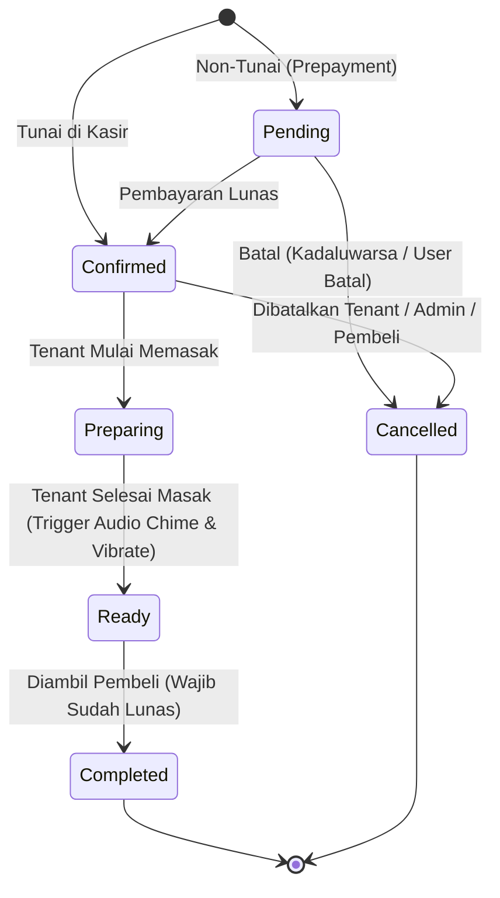
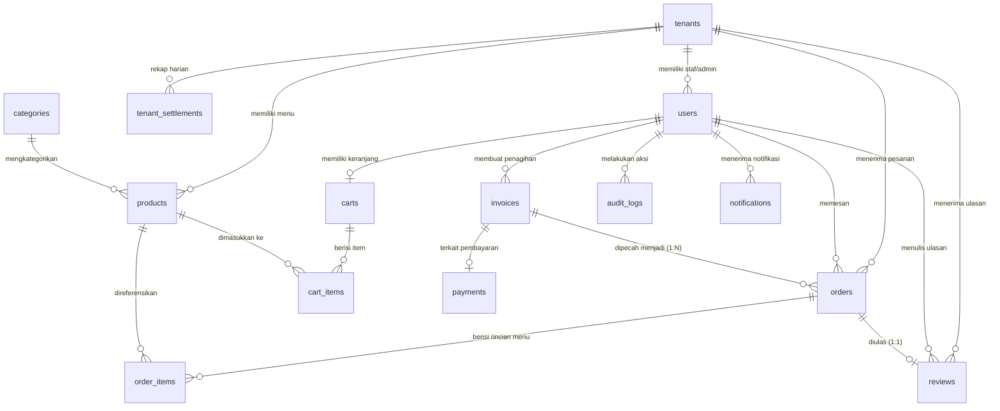

# 📋 ARSITEKTUR SISTEM & SPESIFIKASI TEKNIS: KANTINSMK GO

Dokumen ini disusun sebagai ringkasan arsitektur teknis, model basis data, alur bisnis (*business flow*), dan pola desain perangkat lunak (*software design pattern*) dari aplikasi **KantinSMK Go**. Dokumen ini diformat agar dapat langsung diinput ke dalam Large Language Model (LLM) untuk keperluan audit keamanan, evaluasi arsitektur, pengujian beban/konkurensi, maupun rencana refactor/ekstensi fitur.

---

## 1. RINGKASAN EKSEKUTIF & TEKNOLOGI

* **Nama Aplikasi:** KantinSMK Go (`kantinsmk/go`)
* **Domain / Kasus Penggunaan:** Marketplace kantin sekolah (*GoFood-style*) terpusat untuk 1 lingkungan Sekolah Menengah Kejuruan (SMK).
* **Masalah yang Diselesaikan:** Menghilangkan antrean fisik yang menumpuk saat jam istirahat sekolah yang singkat (15–30 menit) dengan sistem pre-order/pesan-awal multi-tenant, pembayaran terpadu, notifikasi kesiapan pesanan berbasis suara/getar, dan pengambilan mandiri di gerai kantin.
* **Tech Stack Inti:**
  * **Backend Framework:** Laravel 12 (PHP ^8.2)
  * **Frontend & Reactivity:** Livewire 3 + Alpine.js (bawaan Livewire)
  * **Styling:** Tailwind CSS via CDN (Tailwind Play CDN — arsitektur *zero-build-step* tanpa `npm`/Vite)
  * **Basis Data:** MySQL 8
  * **Real-time Engine:** Hybrid — Laravel Reverb / Pusher Protocol WebSockets (kanal privat terautentikasi) dengan *automatic graceful fallback* ke Livewire Polling (interval 6–10 detik) saat WebSocket tidak aktif.
  * **Test Suite:** PHPUnit 11 (28 Feature Tests, 144 assertions, passing 100%).

---

## 2. ACTOR & HAK AKSES (ROLE-BASED ACCESS CONTROL)

Sistem membedakan hak akses pengguna ke dalam 4 peran utama melalui enum `App\Enums\Role`:

| Peran (`role`) | Guard & Scope | Akses & Wewenang Utama |
|---|---|---|
| **`user`** (Pembeli: Siswa/Guru/Staf) | Route prefix: `/`, `/pesanan`, `/keranjang`, `/checkout` | Eksplorasi katalog & tenant, keranjang belanja multi-tenant, simulasi pembayaran QRIS/VA, pelacakan live timeline pesanan, batalkan pesanan mandiri (sebelum diproses), rating & ulasan (1–5 bintang setelah selesai). |
| **`tenant_staf`** (Staf Dapur Tenant) | Route prefix: `/tenant-panel/pesanan` (Scoped ke `tenant_id`) | Mengakses **Papan Pesanan Dapur (Kitchen Display Board)**: memajukan status pesanan (*Dikonfirmasi → Disiapkan → Siap Diambil → Selesai*). |
| **`tenant_admin`** (Pemilik / Kasir Tenant) | Route prefix: `/tenant-panel/*` (Scoped ke `tenant_id`) | Seluruh hak akses staf + Dashboard analitik tenant, CRUD produk menu & switch ketersediaan hari ini (*availability toggle*), buka/tutup toko, verifikasi pelunasan tunai di kasir, pembatalan/refund pesanan tenant, laporan rekap transaksi. |
| **`admin`** (Platform Admin SMK) | Route prefix: `/admin/*` (Global / Unscoped) | Pengawasan transaksi global seluruh tenant, verifikasi & persetujuan tenant baru (*pending/active/suspended*), manajemen pengguna (import massal siswa/guru via CSV, provisioning akun pengelola tenant), audit log, komisi & settlement harian. |

> **Catatan Autentikasi:** Sistem **tidak membuka pendaftaran mandiri secara publik** (*no public registration*). Semua akun dibuat terpusat oleh Admin Platform demi memastikan integritas data warga sekolah (NIS/NIP).

---

## 3. FLOW BISNIS & CARA KERJA SISTEM

### 3.1 Flow Onboarding Pengguna
```
[Admin Platform] ──(Input CSV/Form)──▶ [User Created (is_active=1)]
                                              │
                    ┌─────────────────────────┴─────────────────────────┐
                    ▼                                                   ▼
            Password Diisi                                  Password Dikosongkan
                    │                                                   │
             Siap Login Langsung                             Generate Token Aktivasi
                                                                        │
                                                         Kirim URL: /aktivasi/{token}
                                                                        │
                                                         Pengguna Set Password Sendiri
```
1. Admin memasukkan data siswa/guru secara massal (format teks delimiter `;`: `Nama;Email;NIS/NIP;PasswordOpsional`) atau satu per satu.
2. Jika password tidak disertakan, sistem membuat token aktivasi di `password_reset_tokens` dan membagikan tautan aktivasi satu kali pakai (`/aktivasi/{token}`).
3. Login dilindungi throttle (maksimal 5 kegagalan per menit) dan pengecekan flag `is_active`. Pengguna dengan flag `must_change_password` diwajibkan mengganti kata sandi sebelum dapat bertransaksi.

---

### 3.2 Flow Keranjang Multi-Tenant (Persistent DB Cart)
1. Pembeli memilih menu dari satu atau beberapa tenant yang sedang buka (`is_open = true` dan `status = 'active'`).
2. `CartService` menyimpan keranjang langsung ke basis data (`carts` & `cart_items`) yang terikat dengan `buyer_id`. Keranjang tidak hilang saat sesi browser kedaluwarsa atau saat pembeli berpindah perangkat (misal dari HP ke laptop lab).
3. Produk yang sudah tidak tersedia atau dihapus oleh tenant otomatis dibersihkan saat keranjang dibuka (*self-healing cart*).
4. Di UI keranjang, item dikelompokkan per tenant (`groupedByTenant`) dengan peringatan bahwa saat checkout, transaksi akan dipecah sesuai jumlah tenant.

---

### 3.3 Flow Split Checkout Atomik (ACID Transaction)
Dikelola oleh `App\Services\CheckoutService`:



* **Pessimistic Locking (`lockForUpdate`):** Mencegah race condition ketika banyak siswa checkout menu yang sama di detik yang sama.
* **Price & Name Snapshotting:** Kolom `product_name` dan `unit_price` di `order_items` disalin statis. Jika penjual mengubah harga menu esok hari, riwayat transaksi pembeli tidak terpengaruh.

---

### 3.4 State Machine Pembayaran & Pesanan

#### A. Status Pembayaran (`PaymentStatus`)
* `pending` → Menunggu transfer / scan QRIS / bayar tunai di kasir.
* `paid` → Pembayaran lunas terverifikasi.
* `refunded` → Pesanan dibatalkan setelah sempat lunas.
* `cancelled` → Dibatalkan sebelum dibayar.

#### B. Logika Non-Tunai vs Tunai
* **QRIS / Transfer (Prepayment):**
  * Pesanan berstatus `Order: pending` & `Invoice: pending`.
  * Tenant belum melihat pesanan ini di papan antrean dapur.
  * Begitu invoice ditandai `paid` (via simulasi demo atau webhook gateway nanti): seluruh pesanan anak beralih ke `confirmed`, timestamp `confirmed_at` terisi, dan tenant mendapat notifikasi pesanan baru.
* **Tunai / Cash (Post-payment at pickup):**
  * Pesanan langsung berstatus `Order: confirmed`, namun `payment_status = pending`.
  * Tenant langsung menyiapkan makanan di dapur.
  * **Aturan Kunci Kasir:** Pesanan tunai **tidak dapat diselesaikan (`completed`) sebelum tenant memverifikasi pelunasan uang** (`OrderStatusService::markPaid`).

#### C. Siklus Hidup Pesanan Dapur (`OrderStatus`)


---

### 3.5 Sinkronisasi Status Invoice Otomatis (`syncInvoice`)
Ketika salah satu order anak mengalami perubahan status bayar atau pembatalan, `OrderStatusService` secara otomatis mengevaluasi invoice induknya:
1. Jika semua order aktif dalam invoice sudah lunas → `Invoice` menjadi `paid`.
2. Jika semua order dalam invoice dibatalkan → `Invoice` menjadi `cancelled`.
3. Jika invoice sebelumnya berstatus `paid` namun ada salah satu order anak yang dibatalkan oleh tenant → status invoice berubah menjadi `refunded`.

---

### 3.6 Flow Pembatalan, Refund, dan Auto-Cancel
1. **Pembatalan oleh Pembeli:** Hanya diizinkan jika status pesanan masih `pending` atau `confirmed`. Jika dapur sudah menandai `preparing`, pembeli tidak dapat membatalkan sepihak.
2. **Auto-Cancel Pesanan Tunai Kedaluwarsa:** Command scheduler `kantin:auto-cancel-unpaid` membatalkan otomatis pesanan tunai yang `confirmed` namun tidak diambil/dibayar melebihi `CASH_AUTOCANCEL_MINUTES` (default 60 menit) agar dapur tidak menanggung kerugian makanan terbengkalai.

---

### 3.7 Alerting Sensorik & Realtime (Web Audio API & Vibration)
* Ketika pesanan berganti status menjadi `ready` ("Siap Diambil"), event browser `order-ready` dipicu.
* Tanpa file MP3 eksternal, komponen `x-pickup-alert` menggunakan **Web Audio API** sintetis di browser untuk memainkan harmoni 3 nada sine-wave (*chime*) dan menggetarkan perangkat (*haptic vibration* `[120ms, 60ms, 120ms]`).
* Fitur *Mute toggle* tersimpan di `localStorage` klien.

---

### 3.8 Settlement Harian Tenant & Komisi Platform
Dikelola oleh `SettlementService`:
1. Sistem menghitung omzet kotor pesanan lunas per tenant pada tanggal yang ditentukan.
2. Potongan komisi platform dihitung berdasarkan variabel `.env` `COMMISSION_PERCENT`.
3. Data disimpan di `tenant_settlements` secara idempoten (`updateOrCreate` berdasarkan pasangan `tenant_id` dan `date`).

---

## 4. DESAIN BASIS DATA (DATABASE SCHEMA & RELATIONS)

### 4.1 Skema Relasi Database (ERD)



---

### 4.2 Kamus Data & Spesifikasi Tabel Fisik

#### 1. `tenants`
| Kolom | Tipe Data | Keterangan |
|---|---|---|
| `id` | BIGINT UNSIGNED, PK, AI | Identifikasi unik gerai kantin. |
| `name` | VARCHAR(255) | Nama gerai kantin (misal: "Kantin Bu Rina"). |
| `slug` | VARCHAR(255), UNIQUE | Slug URL ramah SEO/routing. |
| `description` | TEXT, Nullable | Deskripsi singkat gerai. |
| `image_url` | VARCHAR(255), Nullable | Foto/banner gerai. |
| `status` | ENUM('pending', 'active', 'suspended') | Status operasional tenant (Indexed). |
| `is_open` | BOOLEAN, Default true | Switch buka/tutup toko mandiri oleh pemilik. |
| `bank_name`, `bank_account`, `bank_holder` | VARCHAR(255), Nullable | Data rekening bank untuk penarikan saldo/settlement. |
| `created_at`, `updated_at` | TIMESTAMP | Standar Laravel timestamps. |

#### 2. `users`
| Kolom | Tipe Data | Keterangan |
|---|---|---|
| `id` | BIGINT UNSIGNED, PK, AI | Identifikasi unik pengguna. |
| `name` | VARCHAR(255) | Nama lengkap warga sekolah / pengelola. |
| `email` | VARCHAR(255), UNIQUE | Alamat email (kredensial login). |
| `identifier` | VARCHAR(255), UNIQUE, Nullable | Nomor Induk Siswa (NIS) atau NIP Guru/Staf. |
| `password` | VARCHAR(255) | Hash kata sandi (Bcrypt). |
| `role` | ENUM('admin', 'tenant_admin', 'tenant_staf', 'user') | Peran akses pengguna (Indexed). |
| `tenant_id` | BIGINT UNSIGNED, FK, Nullable | Relasi ke `tenants.id` (on delete SET NULL). |
| `is_active` | BOOLEAN, Default true | Flag status aktif akun. |
| `must_change_password` | BOOLEAN, Default false | Memaksa user ganti password saat login pertama kali. |
| `remember_token` | VARCHAR(100), Nullable | Token sesi "ingat saya". |
| `created_at`, `updated_at` | TIMESTAMP | Standar Laravel timestamps. |

#### 3. `categories` & `products`
* `categories`: `id`, `name`, `slug` (Unique), `sort_order` (SmallInt).
* `products`:
  * `id` (BIGINT, PK, AI)
  * `tenant_id` (FK -> `tenants.id`, on delete CASCADE)
  * `category_id` (FK -> `categories.id`, Nullable, on delete SET NULL)
  * `name` (VARCHAR), `description` (TEXT, Nullable), `price` (INT UNSIGNED), `image_url` (VARCHAR, Nullable)
  * `is_available_today` (BOOLEAN, Default true, Indexed) — status menu habis/tersedia hari ini
  * `deleted_at` (TIMESTAMP, Nullable) — **SoftDeletes** (mencegah rusaknya riwayat pesanan lampau).

#### 4. `carts` & `cart_items`
* `carts`: `id`, `buyer_id` (FK -> `users.id`, UNIQUE, on delete CASCADE).
* `cart_items`: `id`, `cart_id` (FK), `product_id` (FK), `qty` (SmallInt), `note` (VARCHAR 120), Unique Constraint pada `(cart_id, product_id)`.

#### 5. `invoices`
| Kolom | Tipe Data | Keterangan |
|---|---|---|
| `id` | BIGINT UNSIGNED, PK, AI | Identifikasi transaksi induk. |
| `code` | VARCHAR(255), UNIQUE | Kode transaksi berformat `INV-yymd-XXXXX`. |
| `buyer_id` | BIGINT UNSIGNED, FK | Pembeli yang melakukan transaksi (on delete CASCADE). |
| `total` | INT UNSIGNED | Nilai total uang seluruh pesanan anak (dalam Rupiah). |
| `payment_method` | ENUM('qris', 'transfer', 'cash') | Metode pembayaran yang dipilih. |
| `payment_status` | ENUM('pending', 'paid', 'refunded', 'cancelled') | Status pelunasan transaksi induk (Indexed). |
| `payment_reference` | VARCHAR(255), Nullable | Referensi kode QRIS / nomor Virtual Account transfer. |
| `paid_at` | TIMESTAMP, Nullable | Waktu pelunasan transaksi. |
| `note` | VARCHAR(200), Nullable | Catatan global dari pembeli. |

#### 6. `orders`
| Kolom | Tipe Data | Keterangan |
|---|---|---|
| `id` | BIGINT UNSIGNED, PK, AI | Identifikasi unik pesanan per tenant. |
| `code` | VARCHAR(255), UNIQUE | Kode pesanan berformat `ORD-yymd-XXXXX`. |
| `invoice_id` | BIGINT UNSIGNED, FK | Referensi ke penagihan induk `invoices.id`. |
| `buyer_id` | BIGINT UNSIGNED, FK | Referensi ke pembeli `users.id`. |
| `tenant_id` | BIGINT UNSIGNED, FK | Tenant tujuan pesanan `tenants.id`. |
| `status` | ENUM('pending', 'confirmed', 'preparing', 'ready', 'completed', 'cancelled') | Tahapan operasional dapur (Indexed). |
| `payment_status` | ENUM('pending', 'paid', 'refunded', 'cancelled') | Status bayar untuk order spesifik ini. |
| `subtotal` | INT UNSIGNED | Total belanja khusus untuk tenant ini. |
| `confirmed_at`, `ready_at`, `completed_at`, `cancelled_at` | TIMESTAMP, Nullable | Rekam jejak waktu tiap milestone pesanan. |
| `cancel_reason` | VARCHAR(255), Nullable | Alasan pembatalan pesanan. |
| **Indexes Tambahan** | INDEX(`tenant_id`, `status`), INDEX(`buyer_id`, `created_at`) | Optimasi query papan antrean dan riwayat user. |

#### 7. `order_items`
Snapshot baris produk pesanan:
* `id`, `order_id` (FK), `product_id` (FK, on delete SET NULL)
* `product_name` (VARCHAR) — *Snapshot nama produk saat dipesan*
* `unit_price` (INT UNSIGNED) — *Snapshot harga satuan saat dipesan*
* `qty` (SmallInt), `line_total` (INT UNSIGNED), `note` (VARCHAR 120, Nullable).

#### 8. `payments`
Tabel abstraksi untuk integrasi payment gateway masa depan:
* `id`, `invoice_id` (FK), `method` (ENUM), `status` (ENUM), `amount` (INT UNSIGNED), `reference` (VARCHAR, Nullable), `paid_at` (TIMESTAMP, Nullable), `verified_by` (FK -> `users.id`, Nullable).

#### 9. `reviews`
Ulasan pembeli untuk tenant:
* `id`, `order_id` (FK, UNIQUE - 1 order hanya bisa diulas 1 kali), `buyer_id` (FK), `tenant_id` (FK), `rating` (TINYINT 1–5), `comment` (VARCHAR 300, Nullable).

#### 10. `tenant_settlements`
Rekapitulasi keuangan harian:
* `id`, `tenant_id` (FK), `date` (DATE), `orders_count` (INT), `gross` (INT), `commission` (INT), `net` (INT), `generated_by` (FK -> `users.id`, Nullable). UNIQUE Key pada `(tenant_id, date)`.

#### 11. `audit_logs` & `notifications`
* `audit_logs`: `actor_id` (FK), `action` (VARCHAR), `subject_type` (VARCHAR), `subject_id` (BIGINT), `meta` (JSON), `ip` (VARCHAR 45), `created_at`.
* `notifications`: `user_id` (FK), `type` (VARCHAR), `payload` (JSON), `read_at` (TIMESTAMP, Nullable). Index: `(user_id, read_at)`.

---

## 5. SOFTWARE DESIGN & POLA ARSITEKTUR

### 5.1 Scoped Multi-Tenancy via Global Eloquent Scopes
* Sistem menggunakan arsitektur **Shared Database, Shared Schema with Logical Scoping**.
* Diimplementasikan melalui trait `App\Models\Concerns\BelongsToTenant` yang menyematkan `TenantScope`:
  ```php
  // app/Models/Scopes/TenantScope.php
  public function apply(Builder $builder, Model $model): void
  {
      $user = auth()->user();
      if ($user && $user->role->isTenant()) {
          $builder->where($model->qualifyColumn('tenant_id'), $user->tenant_id);
      }
  }
  ```
* **Jaminan Keamanan:** Model `Order` dan `Product` secara otomatis terisolasi. Staf Tenant A secara teknis tidak akan pernah dapat melihat atau memodifikasi data milik Tenant B, bahkan jika memanipulasi parameter ID pada request Livewire. Admin Platform dan Pembeli dikecualikan dari scope ini.

---

### 5.2 Service Layer Pattern (Pemisahan Logika Bisnis)
Logika bisnis tidak dicampur ke dalam Controller atau Livewire Component, melainkan didelegasikan ke service murni:
* `CheckoutService`: Menangani locking baris, validasi ketersediaan, pemecahan invoice ke N pesanan, dan pembersihan keranjang dalam 1 transaksi DB.
* `OrderStatusService`: Mengatur transisi status pesanan, validasi prasyarat pelunasan, pembatalan/refund, dan sinkronisasi invoice.
* `CartService`: Abstraksi manipulasi keranjang persisten di basis data.
* `SettlementService`: Mengkalkulasi omzet, komisi, dan bagi hasil harian.
* `AuditLogger`: Standarisasi pencatatan rekam jejak audit sistem.
* `Realtime`: Wrapper broadcast Reverb yang aman (dieksekusi dalam `DB::afterCommit` sehingga kegagalan koneksi WebSocket tidak pernah menggagalkan transaksi basis data).

---

### 5.3 State Machine via PHP 8.2 Backed Enums
Status transaksi, metode pembayaran, dan peran pengguna didefinisikan dengan PHP Enums yang memiliki method fungsional:
* `OrderStatus::next()`: Mengunci alur status operasional yang sah (`confirmed -> preparing -> ready -> completed`).
* `PaymentMethod::requiresPrepayment()`: Menentukan apakah pesanan membutuhkan pembayaran di awal sebelum masuk antrean masak.
* `Role::homeRoute()`: Mengatur navigasi cerdas (*smart redirect*) setelah login berdasarkan hak akses masing-masing akun.

---

### 5.4 Otorisasi Berbasis Kebijakan (Policy-Based Authorization)
Setiap mutasi status pada Livewire dilindungi oleh Laravel Policy (`App\Policies\OrderPolicy`):
* `view`: Hanya pemilik order, staf tenant terkait, atau platform admin.
* `advance`: Hanya staf/admin tenant terkait atau platform admin, dan pesanan belum final.
* `cancel`: Pembeli hanya boleh membatalkan jika status masih `pending`/`confirmed`. Tenant admin hanya untuk tenant sendiri.
* `verifyPayment`: Hanya tenant admin (bukan staf biasa) dan platform admin.
* `review`: Hanya pembeli pemilik order, dan hanya setelah pesanan `completed`.

---

### 5.5 Struktur Direktori Proyek Utama
```
kantinsmk-go/
├── app/
│   ├── Console/Commands/        AutoCancelUnpaid.php, GenerateSettlements.php
│   ├── Enums/                   OrderStatus.php, PaymentMethod.php, PaymentStatus.php, Role.php
│   ├── Events/                  OrderUpdated.php (Event broadcast ke Reverb)
│   ├── Http/
│   │   ├── Controllers/         CronController.php, PaymentWebhookController.php, HomeController.php
│   │   └── Middleware/          EnsureRole.php
│   ├── Livewire/
│   │   ├── Admin/               Dashboard, Transactions, Tenants, Users, Settlements, AuditLogs
│   │   ├── Buyer/               Catalog, TenantMenu, Cart, Checkout, InvoiceShow, Orders, OrderDetail, Account
│   │   ├── Tenant/              OrderBoard, Dashboard, Products, Payments
│   │   └── NotificationsBell.php
│   ├── Models/
│   │   ├── Concerns/            BelongsToTenant.php
│   │   ├── Scopes/              TenantScope.php
│   │   └── User, Tenant, Category, Product, Invoice, Order, OrderItem, Payment, Cart, CartItem, Review, ...
│   ├── Policies/                OrderPolicy.php, ProductPolicy.php, TenantPolicy.php
│   └── Services/                CartService, CheckoutService, OrderStatusService, Realtime, SettlementService, AuditLogger
├── database/
│   ├── migrations/              Core Tables (000001) & Transaction Tables (000002)
│   └── seeders/                 DatabaseSeeder.php (Idempoten via updateOrCreate)
├── resources/views/
│   ├── components/layouts/      base.blade.php, app.blade.php, panel.blade.php
│   └── components/              pickup-alert.blade.php, status-badge, ...
└── routes/web.php               Definisi rute terproteksi role & webhook
```

---

## 6. PANDUAN PROMPT UNTUK LLM PENGKAJI (EVALUATION PROMPT)

Salin blok prompt di bawah ini bersama seluruh dokumen spesifikasi di atas ke dalam LLM untuk melakukan analisis mendalam:

```markdown
Anda bertindak sebagai Principal Software Architect, Senior Laravel/PHP Engineer, dan Lead Cybersecurity Specialist.
Di atas adalah dokumen spesifikasi teknis lengkap dari aplikasi "KantinSMK Go".

Tolong lakukan analisis komprehensif terhadap aplikasi ini dengan mengkaji aspek-aspek berikut:

1. KUALITAS DESAIN ARSITEKTUR & REFACTORING
- Evaluasi arsitektur Split Checkout (1 Invoice ke N Orders), Scoped Multi-Tenancy (TenantScope), dan Hybrid Real-time (WebSockets + Polling fallback).
- Apakah ada potensi pelanggaran SOLID, over-engineering, atau code smell pada Service Layer atau Livewire Components?

2. KONKURENSI & RACE CONDITIONS
- Analisis potensi race condition saat jam istirahat sekolah (misal: 300 siswa menekan tombol checkout pada detik yang sama).
- Evaluasi penggunaan `Product::lockForUpdate()` di CheckoutService: apakah ada resiko database deadlock ketika dua pembeli memesan produk dari tenant yang sama dengan urutan ID berbeda?

3. AUDIT KEAMANAN & OTORISASI (PENETRATION TESTING PERSPECTIVE)
- Identifikasi potensi celah IDOR (Insecure Direct Object Reference) atau manipulasi properti di Livewire Component.
- Evaluasi keamanan endpoint webhook `/webhook/payment/{invoice}` dan endpoint cron `/cron/*` yang dilindungi bearer secret.
- Apakah ada celah kebocoran data (*data leakage*) antar tenant?

4. INTEGRASI PAYMENT GATEWAY PRODUKSI (MIDTRANS / XENDIT)
- Teliti seam tabel `payments` dan controller `PaymentWebhookController`.
- Buatkan rancangan teknis transisi dari simulasi demo saat ini menjadi integrasi Midtrans Snap/Core API yang aman (meliputi verifikasi hash signature, handling status capture/settlement/expire/deny, dan idempotency key).

5. SKALABILITAS & FITUR TAMBAHAN OPERASIONAL
- Berikan rekomendasi indeks database tambahan, strategi caching (Redis/file), dan antrean job (Queue workers).
- Fitur apa saja yang penting ditambahkan untuk operasional kantin sekolah nyata (misal: kuota harian per menu/stock counter, jam operasional otomatis sesuai jam istirahat, sistem saldo kartu RFID siswa)?
```
